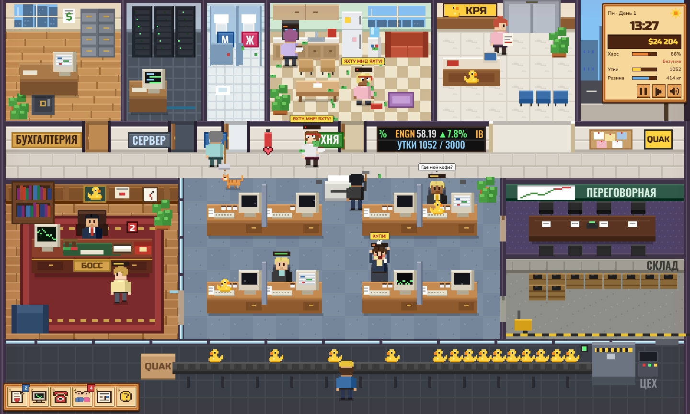
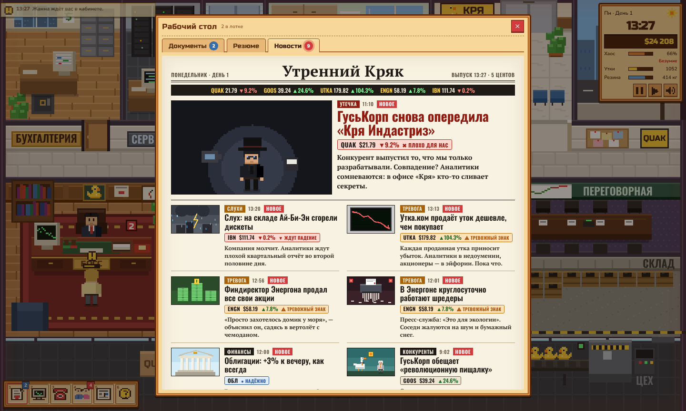

# My Little Office 🦆

Пиксельный симулятор менеджера в духе уютных фермерских игр — только вместо грядок у вас офис фабрики резиновых уток «Кря Индастриз», а вместо урожая — шпионы конкурентов, горы документов и сотрудники, медленно сходящие с ума.



## Суть

Вы сидите за столом в своём кабинете. Вокруг — целый этаж: бухгалтерия, серверная, туалет, кухня с котом, ресепшен с лифтом, опен-спейс, переговорная, склад резины и цех с конвейером. Каждый рабочий день длится **с 9:00 до 18:00**, вечером — совет директоров, а утром — следующий день. Дни идут один за другим, и всё, что вы сделали вчера, остаётся с вами сегодня.

## День за днём

После совета директоров игра не начинается заново — наступает утро следующего дня (Пн → Вт → Ср → Чт → Пт, потом снова понедельник):

- **Деньги, акции, облигации, резина на складе и репутация** переходят в новый день. Прибыль считается за день.
- **Сотрудники** за ночь отдыхают, но не полностью: если вечером офис превратился в Уолл-стрит, утро начнётся на нервах. Отправленные домой возвращаются бодрыми. Улики и подозрения в досье сохраняются («вчера…»), лентяи могут снова разлениться.
- **Шпион, которого не уволили, остаётся** и продолжает сливать секреты. Если своих людей у ГусьКорп не осталось, она может завербовать кого-то из недовольных.
- **Вчерашние поступки возвращаются бумагами**: после облавы приходит предписание Комиссии, после записи разговора с Гусевым — его иск, после увольнения невиновного — претензия, после взятого конверта — служебная проверка. Неразобранные документы ждут в лотке с пометкой «со вчера».
- **Биржа живёт дальше**: курсы и портфель сохраняются, лопнувшая Утка.ком стоит копейки, обанкротившийся Энергон — пыль, а каждый день приносит новые слухи и скачки.
- **Покупки остаются**: массажное кресло и новая кофемашина работают во все следующие дни.
- **Карьера**: повышение (должность растёт, план тоже), «оставлен», штраф (предупреждение) или увольнение. Два штрафа подряд — увольнение. На экране вердикта — должность, ваш личный кошелёк, предупреждения и история дней.
- **Сохранение** — в браузере, автоматически каждые несколько секунд, при паузе и при закрытии вкладки: вернувшись, вы продолжите с той же минуты дня (документы в лотке, новости, акции и люди — на месте). В меню паузы есть «Сохранить» и «Сохранить и выйти в меню».
- **Новая игра и архив.** «Новая игра» начинает новую карьеру, а прежняя остаётся в **архиве** на заставке: оттуда любую карьеру можно продолжить или удалить. Карьеры, закончившиеся увольнением, хранятся в архиве как история.

## Найм сотрудников

Когда сотрудник уходит — вы его уволили, он сбежал в ГусьКорп или не выдержал и уволился за ночь, — стол пустеет, и в лоток начинают приходить **резюме кандидатов**: фото, возраст, опыт, хобби, рекомендации, ожидаемая зарплата и сопроводительное письмо. Штамп «согласовано» на резюме — человек выходит из лифта и садится за свободный стол.

Читайте внимательно: лентяи пишут про «спокойное место без авралов», сон и диван, а ГусьКорп подсылает «кандидатов» с опытом в «Гусином Пухе», гусиными рекомендациями и желанием попасть в серверную с первого дня. Звёзды стоят дороже, но работают за двоих. За $250 кадровое агентство пришлёт проверенных людей.

## Рабочий стол и газета

Лоток документов — это **рабочий стол с тремя вкладками: Документы, Резюме и Новости**. Принимая решение по инвестиции, можно открыть газету прямо там же, не уходя к терминалу (`N` — газета, `Q` — следующая вкладка).



Новости оформлены как настоящая газета **«Утренний Кряк»**: большие заголовки, пиксельные иллюстрации, главная новость дня и сетка заметок. У каждой заметки о бирже — плашка с бумагой, ценой, изменением за день и смыслом новости: «ажиотаж», «тревожный знак», «обвал», «ждут рост», «надёжно». Слухи выходят заранее — успейте купить или продать.

## Этаж и комнаты

Каждая комната кликабельна и для чего-то нужна:

| Комната | Зачем |
|---|---|
| Ваш кабинет | стол со штампами, лотком документов, телефоном и терминалом; сюда приходят сотрудники |
| Опен-спейс | восемь сотрудников за стеклом — досье, выработка, рассудок |
| Бухгалтерия | баланс и финансы, сейф; здесь сидит Зинаида Петровна |
| Серверная | **журнал доступа**: кто и когда заходил без допуска. Сисадмин Ахмет замечает чужих, только когда сидит на месте |
| Туалет | видно, кто там засел и как долго — лентяи прячутся по полчаса |
| Комната отдыха | кофемашина, холодильник, кулер, диван и кот Кексик; заказ кофе, пиццы и музыки |
| Ресепшен | секретарь Галя и лифт — через него приходят курьеры и уходят уволенные |
| Переговорная | **планёрка** (+рассудок и +6% к выработке, но конвейер простаивает) и сеансы психолога |
| Склад резины | запас, расход, едущие поставки, срочный заказ; ящики на полу тают по мере работы |
| Цех | конвейер с утками и мастер Михалыч, который чинит пресс при поломке |

## Офис живёт сам

- **Сотрудники отходят от столов**: за кофе, к холодильнику, поболтать у кулера (с настоящими сплетнями), погладить и покормить кота, на диван, пообедать, в туалет, к принтеру, в серверную. Пока человек не за столом, он не производит уток, зато перерыв немного возвращает рассудок.
- **Сами приходят к менеджеру** с причиной: жалоба на орущего соседа, гениальная идея про уток-космонавтов, просьба уйти пораньше, донос на коллегу (иногда ложный), аванс, удалёнка, сбор на торт, благодарность за премию. Шпион может заглянуть с невинным вопросом «а где лежат чертежи?» — и ему можно подсунуть фальшивку. Сошедший с ума врывается с криком «ПРОДАЙ МНЕ ЭТУ УТКУ!». Если долго не принимать посетителя, он обидится и уйдёт.
- **Персонал**: Галя разносит документы и кофе, Ахмет чинит принтер и компьютеры, Зинаида Петровна проверяет сейф, тётя Валя убирает бумажки и пролитый кофе (мусор тоже действует на нервы), Михалыч бродит по цеху.
- **Гости из лифта**: курьер с ящиком резины (у входа паркуется грузовик), разносчик пиццы, доктор Утешев с планшетом.
- **Кот Кексик** гуляет по всему этажу, спит на лежанке и диване, сидит рядом с сотрудниками (рядом с ним люди сходят с ума медленнее). Голодный кот мяукает у миски, а если его долго не кормить — садится прямо на ваши документы.

- **Документы.** В лоток на столе падают счета, договоры, инвестиционные предложения и анонимки. Берёте штамп «СОГЛАСОВАНО» или «ОТКАЗАНО» и ставите его прямо на бумагу. Среди документов встречаются подставные фирмы, офшорные «клиенты» и пузыри доткомов.
- **Сотрудники.** Клик по человеку открывает досье: рассудок, выработка, подозрительные наблюдения. Подозрительных можно вызвать «на ковёр» — расспросить, обыскать портфель, поговорить по душам, выдать премию, оштрафовать, отправить домой или уволить.
- **Шпионы ГусьКорп.** Один-два сотрудника работают на конкурента: фотографируют чертежи, копируют дискеты. Пока шпион на месте — случаются утечки. Пойманного шпиона можно уволить или перевербовать в двойного агента. Уволить невиновного — плохая идея.
- **Лентяи.** Спят на клавиатуре и раскладывают «Косынку». Выдаёт их выработка в досье.
- **Безумие.** Полоска над головой — рассудок. Ближе к вечеру люди сходят с ума быстрее и заражают соседей. Если ничего не делать, к концу дня офис превратится в Уолл-стрит начала 2000-х: галстуки на головах, крики «Продай мне эту утку!», деньги из окон, а потом и облава Комиссии по ценным бумагам. Помогают кофе, пицца, спокойная музыка, психолог, разговоры и отгулы.
- **Финансы.** Утки приносят выручку, пока на складе есть резина. В терминале на столе — баланс, прогноз прибыли и биржа: свои акции, конкурент, «Утка.ком» с пузырём, «Энергон» со сложной отчётностью и скучные, но надёжные облигации. Новости подсказывают, что скоро лопнет.
- **Совет директоров.** В 18:00 пятеро директоров разбирают ваш день: производство, прибыль, решения по документам, шпионов, хаос и репутацию. Итог — повышение, оставление на должности, штраф или увольнение, а затем — следующий день.

Каждый день другой: набор документов, звонки (Гусев с каждым разом предлагает больше), слухи и поведение рынка.

## Установить как приложение

Игру можно поставить на компьютер или телефон прямо с сайта, без App Store и Google Play: на заставке есть зелёная кнопка **«Установить игру»**. После установки появляется значок с уткой, игра открывается в своём окне на весь экран и работает **без интернета**. Обновления подтягиваются сами при следующем запуске с интернетом.

| Устройство | Как |
|---|---|
| Windows, Mac — Chrome, Edge, Яндекс Браузер | «Установить игру» → «Установить» (или значок ⊕ в адресной строке) |
| Mac — Safari | «Файл» → «Добавить в Dock» |
| Android | «Установить игру» или меню ⋮ → «Установить приложение» |
| iPhone, iPad — Safari | «Поделиться» → «На экран „Домой“» |

Firefox не умеет устанавливать сайты как приложения — для установки откройте игру в другом браузере.

## Как запустить

Игра — обычная статичная страница без сборки и зависимостей.

- **GitHub Pages:** в репозитории откройте *Settings → Pages*, выберите *Deploy from a branch*, ветку `main` и папку `/ (root)`. Через минуту игра будет доступна по адресу `https://beknazarberikbosyn-dot.github.io/My-Little-Office/`.
- **Локально:** откройте `index.html` в браузере. Или запустите в папке проекта `python3 -m http.server` и зайдите на `http://localhost:8000`.

## Управление

| Действие | Как |
|---|---|
| Досье сотрудника | клик по человеку за стеклом |
| Рабочий стол, терминал, телефон | клик по лотку, монитору, телефону на столе или хотбар |
| Панели хотбара | `1` – `6` |
| Газета | `N` |
| Вкладки рабочего стола | клик или `Q` |
| Штамп «согласовано» / «отказано» | взять штамп мышью и кликнуть по бумаге, или `A` / `D` |
| Пауза | `Пробел` |
| Ускорить время ×2 | `F` |
| Звук | `M` |
| Закрыть окно | `Esc` |

Пока открыт рабочий стол, время идёт вдвое медленнее, во время разговоров — вчетверо.

## Устройство проекта

```
index.html        разметка и интерфейс
style.css         деревянные рамки, окна, диалоги, анимации
favicon.svg       пиксельная утка
js/
  util.js         утилиты
  font.js         надписи на холсте (табло, таблички) настоящими шрифтами в разрешении экрана
  audio.js        звуки и чиптюн-музыка на WebAudio
  data.js         имена, реплики, улики, сплетни, события хаоса
  map.js          план этажа: комнаты, двери, мебель, поиск пути по сетке
  sprites.js      человечки, кот, утки, иконки — всё рисуется кодом
  news.js         газета «Утренний Кряк»: заметки, пиксельные иллюстрации, вёрстка
  market.js       биржа: курсы и портфель между днями, пузырь, скандал, слухи, облигации
  content.js      документы, звонки, утренняя сводка, причины визитов сотрудников
  hire.js         найм: вакансии, кандидаты со скрытым характером, резюме
  sim.js          симуляция дня, переход к следующему дню, карьера, снимок для сохранения
  saves.js        слоты сохранений: текущая карьера и архив
  install.js      кнопка «Установить игру» и подсказки для каждого устройства
sw.js             офлайн-кэш (service worker)
manifest.webmanifest  название, иконки и режим окна установленного приложения
icons/            иконки приложения
  npc.js          жизнь офиса: дела сотрудников, персонал, гости, кот, мусор
  world.js        отрисовка этажа, мебели, людей, частиц и реплик
  ui.js           часы, хотбар, окна комнат, штампы, диалоги
  board.js        совет директоров и вердикт
  main.js         игровой цикл и управление
```

Вся графика и звук генерируются в коде — внешних картинок и аудиофайлов нет. Шрифты лежат в папке `fonts/` (Nunito — текст интерфейса, Russo One — заголовки и часы, Oswald — газетные заголовки и табло, PT Serif — текст газеты), все под лицензией SIL Open Font License, тексты лицензий рядом. Игра работает без интернета.

## Что дальше

Идеи: корпоратив в пятницу, ответные ходы ГусьКорп, отпуска и больничные, новые отделы на этаже.
